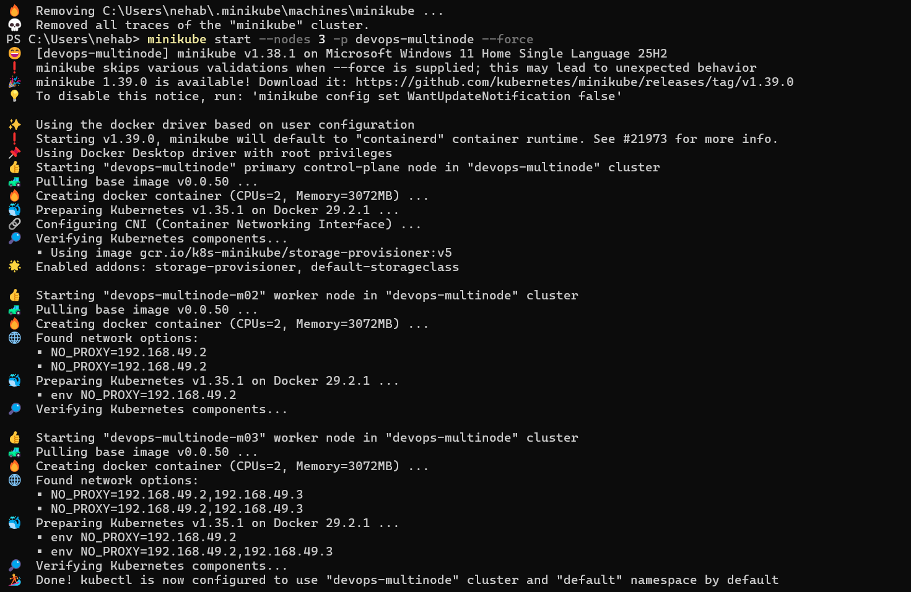
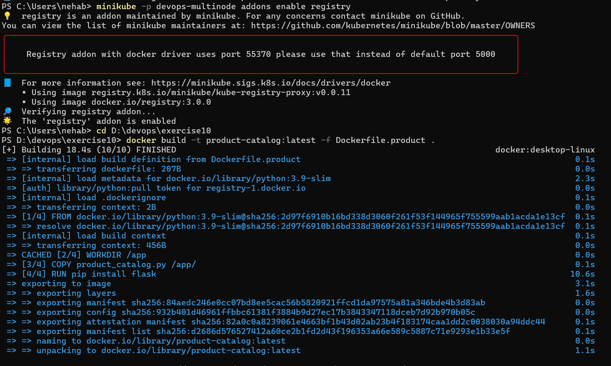
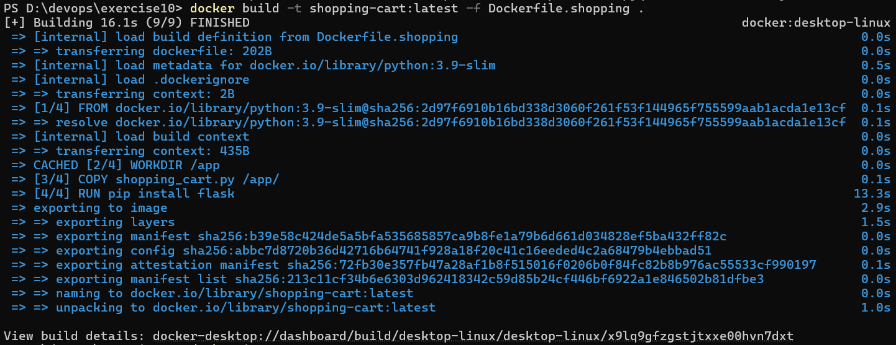
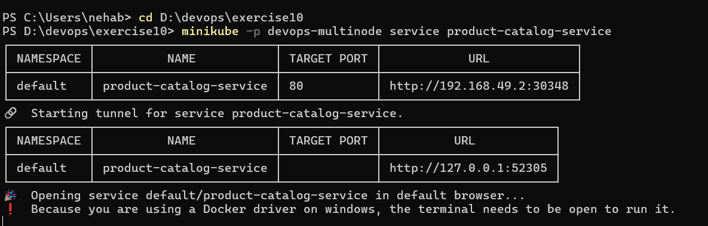
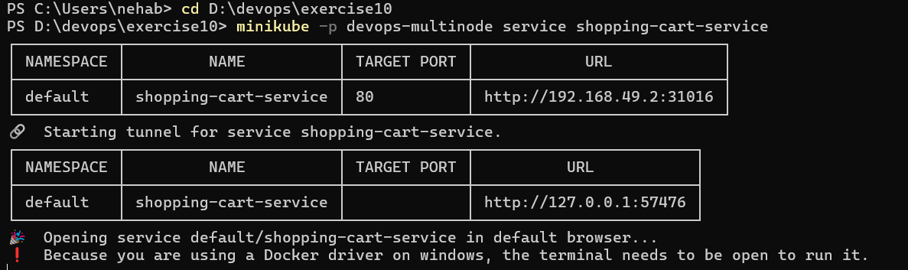
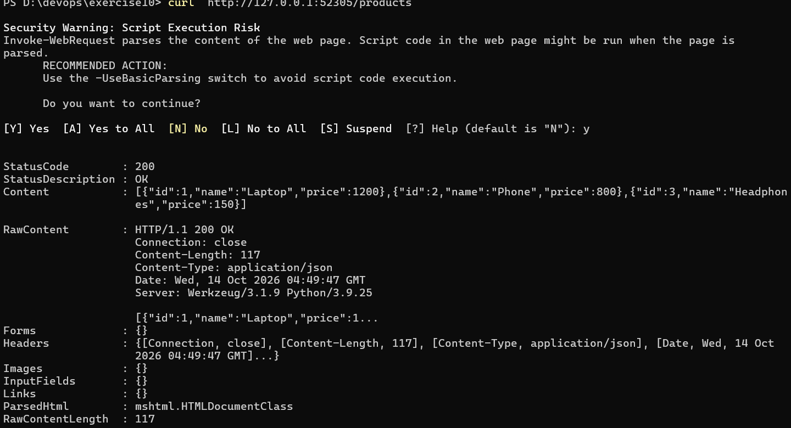
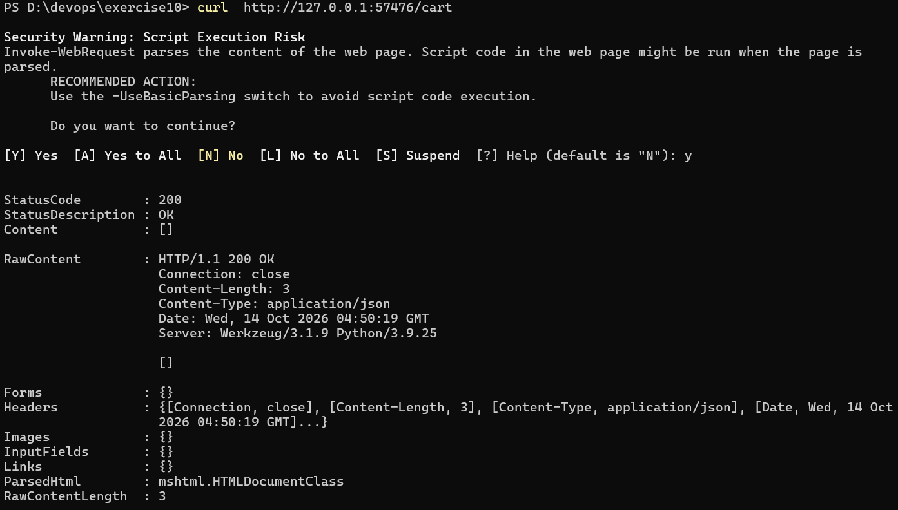
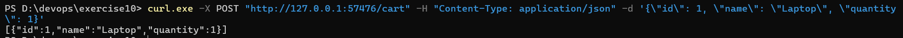

# Exercise 10: Multi-Node Kubernetes Cluster with Multiple Applications and ReplicaSets

## Objective

Deploy two Flask microservices on a 3-node Minikube cluster, with each replica placed on a different node via pod anti-affinity:

| Service | App | Replicas |
|---|---|---|
| Product Catalog | AppA | 2 |
| Shopping Cart | AppB | 3 |


## Environment

| Item | Value |
|---|---|
| OS | Microsoft Windows 11 Home Single Language 25H2 |
| Minikube | v1.38.1 (v1.39.0 available) |
| Kubernetes | v1.35.1 |
| Container runtime / driver | Docker 29.2.1 / Docker Desktop driver |
| Profile | `devops-multinode` |
| Working directory | `D:\devops\exercise10` |

---

## Step 0 and 1a: Clean up and start a 3-node cluster

The existing `minikube` cluster was removed, then the multi-node cluster was created:

```powershell
minikube start --nodes 3 -p devops-multinode --force
```

**Result:** The cluster started with three nodes, each created with CPUs=2 and Memory=3072MB:

- `devops-multinode` (primary control-plane)
- `devops-multinode-m02` (worker)
- `devops-multinode-m03` (worker)

Addons enabled by default: `storage-provisioner`, `default-storageclass`. Minikube reported:
`Done! kubectl is now configured to use "devops-multinode" cluster and "default" namespace by default`


> **Screenshot 1:** Minikube cleanup and 3-node cluster start
>
> 


## Step 1b: Enable the registry addon

```powershell
minikube -p devops-multinode addons enable registry
```

**Result:** `The 'registry' addon is enabled`

- Registry addon port with the Docker driver: **55370** (instead of default 5000).
- Images used: `registry.k8s.io/minikube/kube-registry-proxy:v0.0.11` and `docker.io/registry:3.0.0`.


> **Screenshot 2:** Registry addon enabled and product-catalog image build
>
> 

## Steps 2 to 4: Application code and Docker images

Created `product_catalog.py`, `shopping_cart.py`, `Dockerfile.product` and `Dockerfile.shopping` as given in the exercise.

```powershell
docker build -t product-catalog:latest -f Dockerfile.product .
docker build -t shopping-cart:latest -f Dockerfile.shopping .
```

| Image | Build result | Build time |
|---|---|---|
| `product-catalog:latest` | FINISHED (10/10) | 18.4s |
| `shopping-cart:latest` | FINISHED (9/9) | 16.1s |

Both images are based on `python:3.9-slim`, with `pip install flask` as the longest step (10.6s and 13.3s).


> **Screenshot 3:** shopping-cart image build
>
> 

## Step 5: Load images into Minikube

```powershell
minikube -p devops-multinode image load product-catalog:latest
minikube -p devops-multinode image load shopping-cart:latest
minikube -p devops-multinode ssh -- docker images
```

**Result:** Both images were present in the node, alongside the Kubernetes system images:

| Image | ID | Disk usage |
|---|---|---|
| `product-catalog:latest` | 932b401d4696 | 134MB |
| `shopping-cart:latest` | abbc7d8720b3 | 134MB |
| `registry.k8s.io/kube-apiserver:v1.35.1` | 6f9eeb0cff98 | 89.8MB |
| `registry.k8s.io/kube-controller-manager:v1.35.1` | 8d7002962c48 | 75.8MB |
| `registry.k8s.io/kube-scheduler:v1.35.1` | 5f2a969bc7a4 | 51.7MB |
| `registry.k8s.io/kube-proxy:v1.35.1` | 6521110cdb01 | 70.4MB |
| `registry.k8s.io/etcd:3.6.6-0` | 0a108f718956 | 62.5MB |
| `registry.k8s.io/coredns/coredns:v1.13.1` | aa5e3ebc0dfe | 78.1MB |
| `registry.k8s.io/pause:3.10.1` | cd073f4c5f6a | 736kB |
| `kindest/kindnetd:v20260213-ea8e5717` | c4409203da81 | 106MB |
| `gcr.io/k8s-minikube/storage-provisioner:v5` | 6e38f40d628d | 31.5MB |

(The `ssh -- docker images` output used the newer table format, with the `U` "In Use" marker.)


> **Screenshot 4:** Image load, `docker images` inside the node, and `kubectl apply` of all manifests (including the namespace error)
>
> 

## Steps 6 and 7: Deploy the applications and services

```powershell
kubectl apply -f product_catalog_deployment.yaml
kubectl apply -f shopping_cart_deployment.yaml
kubectl apply -f product_catalog_service.yaml
kubectl apply -f shopping_cart_service.yaml
```

**Output:**

```
deployment.apps/product-catalog created
Error from server (NotFound): error when creating "shopping_cart_deployment.yaml": namespaces "devops-exercise" not found
deployment.apps/shopping-cart created
service/product-catalog-service created
service/shopping-cart-service created
```

### Issue encountered and fix

The first apply of `shopping_cart_deployment.yaml` failed because the manifest specified `namespace: devops-exercise`, which does not exist in the cluster. The other manifests use `default`.

**Fix:** Changed the namespace in `shopping_cart_deployment.yaml` to `default` (consistent with the rest of the exercise; alternatively, create the namespace with `kubectl create namespace devops-exercise`). Re-applying succeeded: `deployment.apps/shopping-cart created`.

## Step 8: Verify pod distribution

```powershell
kubectl get pods -o wide
```

```
NAME                               READY   STATUS    RESTARTS   AGE     IP           NODE                   
product-catalog-6794cdc954-qls7b   1/1     Running   0          3m23s   10.244.1.4   devops-multinode-m02   
product-catalog-6794cdc954-wksqx   1/1     Running   0          3m23s   10.244.2.3   devops-multinode-m03   
shopping-cart-7bf585c6f8-2ds68     1/1     Running   0          2m29s   10.244.2.4   devops-multinode-m03   
shopping-cart-7bf585c6f8-ljfrt     1/1     Running   0          2m29s   10.244.0.4   devops-multinode       
shopping-cart-7bf585c6f8-wd92g     1/1     Running   0          2m29s   10.244.1.5   devops-multinode-m02   
```

### Pod-to-node distribution

| Node | Product Catalog pods | Shopping Cart pods |
|---|---|---|
| `devops-multinode` | none | `shopping-cart-...-ljfrt` |
| `devops-multinode-m02` | `product-catalog-...-qls7b` | `shopping-cart-...-wd92g` |
| `devops-multinode-m03` | `product-catalog-...-wksqx` | `shopping-cart-...-2ds68` |

All 5 pods are `1/1 Running` with 0 restarts. The `requiredDuringSchedulingIgnoredDuringExecution` pod anti-affinity (topologyKey `kubernetes.io/hostname`) worked as intended: no two replicas of the same app share a node.

- Product Catalog (2 replicas) is on 2 different nodes.
- Shopping Cart (3 replicas) is spread across all 3 nodes, one per node.


> **Screenshot 5:** `kubectl get pods -o wide` showing pod distribution across nodes
>
> 

## Step 9: Access the services

```powershell
minikube -p devops-multinode service product-catalog-service
minikube -p devops-multinode service shopping-cart-service
```

| Service | NodePort URL | Tunnel URL (used for testing) |
|---|---|---|
| `product-catalog-service` | http://192.168.49.2:30348 | **http://127.0.0.1:52305** |
| `shopping-cart-service` | http://192.168.49.2:31016 | **http://127.0.0.1:57476** |

Minikube noted that with the Docker driver on Windows, the terminal running the tunnel must stay open.


> **Screenshot 6:** Product Catalog service URL and tunnel
>
> 

> **Screenshot 7:** Shopping Cart service URL and tunnel
>
> 

## Step 10: Testing

PowerShell aliases `curl` to `Invoke-WebRequest`, so the GET requests showed a security prompt (answered `y`). `curl.exe` was used for the POST request.

### Test 1: Product Catalog, list products

```powershell
curl http://127.0.0.1:52305/products
```

**Result:** `StatusCode: 200 OK`

```json
[{"id":1,"name":"Laptop","price":1200},{"id":2,"name":"Phone","price":800},{"id":3,"name":"Headphones","price":150}]
```

Response headers: `Content-Type: application/json`, `Content-Length: 117`, `Server: Werkzeug/3.1.9 Python/3.9.25`. This matches the expected response.


> **Screenshot 8:** GET /products response
>
> 

### Test 2: Shopping Cart, get empty cart

```powershell
curl http://127.0.0.1:57476/cart
```

**Result:** `StatusCode: 200 OK`, `Content: []`, `Content-Length: 3`. The cart is empty initially, as expected.


> **Screenshot 9:** GET /cart returning an empty list
>
> 

### Test 3: Shopping Cart, add an item

```powershell
curl.exe -X POST "http://127.0.0.1:57476/cart" -H "Content-Type: application/json" -d '{\"id\": 1, \"name\": \"Laptop\", \"quantity\": 1}'
```

**Result:**

```json
[{"id":1,"name":"Laptop","quantity":1}]
```

The item was added and returned in the cart, as expected.


> **Screenshot 10:** POST /cart adding an item
>
> 

---

## Summary

| Check | Status |
|---|---|
| 3-node Minikube cluster (`devops-multinode`) | Passed |
| Registry addon enabled | Passed |
| Docker images built and loaded into the cluster | Passed |
| Product Catalog: 2 replicas on different nodes | Passed |
| Shopping Cart: 3 replicas on different nodes | Passed |
| Services exposed via NodePort and tunnel | Passed |
| `GET /products` returns product list | Passed |
| `GET /cart` returns empty list | Passed |
| `POST /cart` adds item | Passed |

Both applications were deployed on the multi-node Minikube cluster with ReplicaSets, and pod anti-affinity placed each replica of a service on a different node. If one node fails, the remaining replicas keep serving traffic, which gives the availability and fault tolerance the exercise set out to demonstrate.

**Observation:** One caveat is that the Shopping Cart stores its data in an in-memory Python list per pod. With 3 replicas behind a Service, a cart added through one pod will not be visible from the other pods, so a shared store such as Redis or a database would be needed in production.